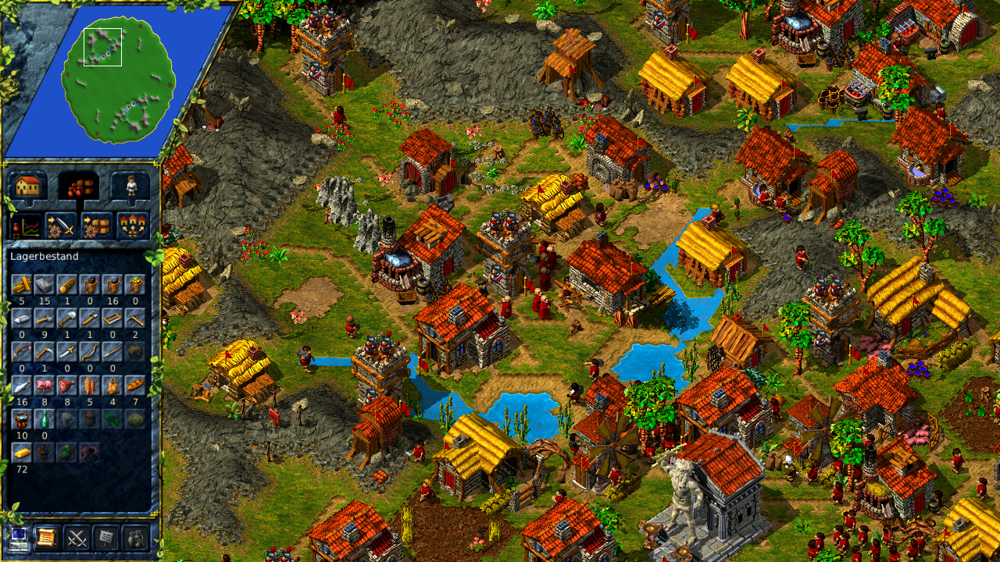
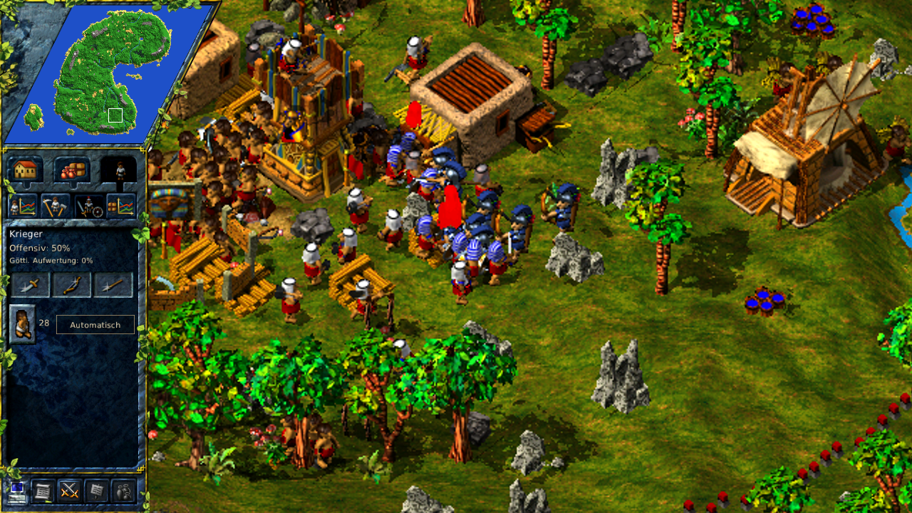
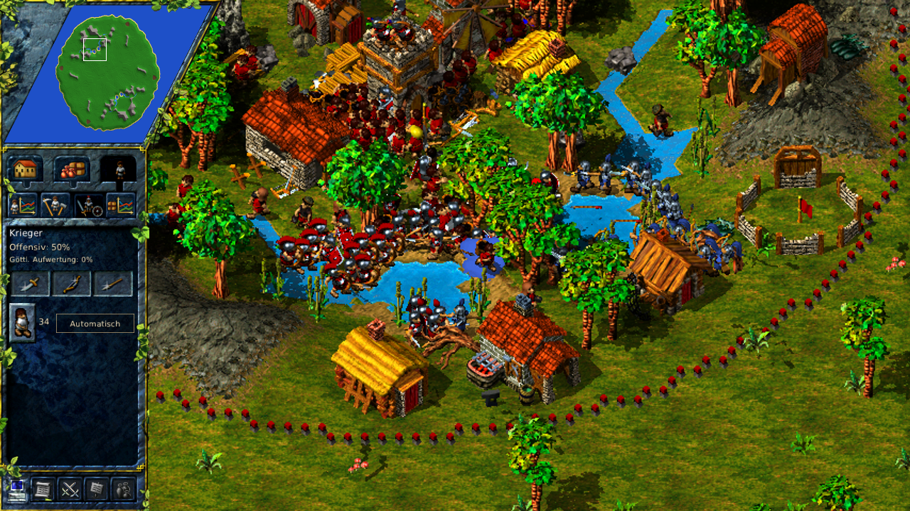
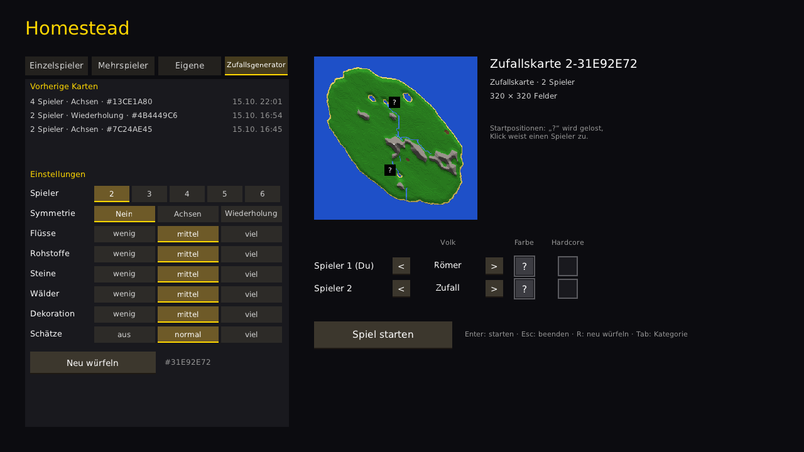

# monoSettlers

**A remake of "The Settlers III" in C# and MonoGame – with a strong AI, carriers that never get stuck, and mountains that don't run dry in no time.**



The graphics come from your own copy of the original game and are read at runtime. Game logic, rendering, AI and tools are
written from scratch – the [clean-room way](#clean-room-how-this-game-is-made). The original is full of bugs and hasn't been maintained for years; monoSettlers plays like the game you
remember, minus the old annoyances.

## Combat

| Skirmish at the tower | Pitched battle |
|---|---|
|  |  |
| Enemies storm the starting tower; the garrison fights back, bowmen shoot from the tower. | Two armies of 30 clash in the middle of the village (staged with the capture option `BATTLE=big`). |

- **Swordsmen, pikemen and bowmen** in three ranks; combat strength depends on territory and gold
- **Conquer towers, large towers and castles**: break down the door, defeat the defenders in front of it, take the building
- **RTS-style controls**: drag to select, groups on Ctrl+1–9, forced moves with Ctrl, orders by right-clicking the minimap
- **Hospitals, priests and spells** per people: convert, samurai sword, freeze, scatter, summon goods
- **Divine upgrades** for soldiers, paid with mana from wine, mead, beer or rice liquor
- **Geologists, scouts and pioneers**: prospect for resources, steal goods, claim land without a tower

## Economy

- **Four peoples** (Romans, Egyptians, Asians, Amazons) with their own buildings, production chains and settlers
- **Logistics without traffic jams**: carriers step aside, swap places and re-plan; a watchdog resolves every deadlock
- **Trails**: well-used routes turn into footpaths you walk faster on
- **Levelling** with real terrain changes, construction sites with diggers and builders
- **Controls like the original**: distribution, transport order, storehouses specialised on one good, smith shares and orders, production statistics
- **Configurable balancing** in JSON: amounts in mountains, fish and stone up to "infinite", production times, recipes

## AI

Computer opponents use the same commands as a human player and each has its own character:

| Character | People | Style |
|---|---|---|
| Hothead | Egyptians | Early army, attacks with everything |
| Unyielding | Asians | Holds on long, gives up only below half strength |
| Legion | Romans | Early gold, attacks in waves, pincer moves |
| Skirmisher | Amazons | Small squads, nearby targets, campaigns only at 2:1 |

On top of that: guerilla strikes, defence by threat, gathered campaigns, retreats when outnumbered, targeted expansion towards missing resources.
The **Arena** (`tools/Homestead.Arena`) runs AI against AI without a window; a tournament script compares characters across many maps.

## Maps



- All single-player and multiplayer maps of the original
- **Random maps** for 2–6 players with mirrored or repeated symmetry, rivers, swamps, ore veins and treasures – fair for every start position
- **Hardcore mode** per player, **save games** in 8 slots, **fog of war**

## Clean room: how this game is made

Imagine you want to build a car that drives exactly like a famous old model, but you are **not** allowed to copy its
blueprints. What you *may* do is drive the old car, watch closely what it does, measure it from the outside – and then
design your own car from scratch so that it behaves the same. That is the "clean room" method, and it is how
monoSettlers is built.

**What we do:**
- **Play the original and watch.** How fast does a carrier walk? When does a soldier attack? How does a farm grow?
  We observe the behaviour and write our own code that behaves the same way.
- **Read the data files.** Graphics, maps and sounds are stored in files with a certain format. Figuring out such a
  file format is like learning to read a foreign alphabet – it tells us how to *open* the files, nothing more.
  The files themselves stay on your computer and come from your own copy of the game.
- **Use open-source work.** Some code and data tables come from the open-source project
  [JSettlers](https://github.com/paulwedeck/settlers-remake), which allows this under its MIT License.

**What we never do:**
- **We never look inside the original program.** No decompiling, no disassembling, no debugging of the original
  EXE or DLLs. We don't know – and don't want to know – how Blue Byte wrote their code.
- **We never copy original code**, not even from leaked or decompiled sources found on the internet.
- **We never ship original content.** No graphics, sounds, maps or music are in this repository, in a build or in a
  download. Without your own copy of the game, monoSettlers shows nothing.
- **We never bypass copy protection.**

In short: the *program* is 100 % our own, the *content* is 100 % yours – from the game you bought.

## Getting started

You need .NET 9 and your own copy of "The Settlers III".

### Getting the original game

The Settlers III is sold DRM-free on GOG as the **Ultimate Collection** (base game, Quest of the Amazons and Mission CD):

- Buy: <https://www.gog.com/en/game/the_settlers_3_ultimate_collection>
- Download after buying: in your GOG library at <https://www.gog.com/en/account> or with [GOG Galaxy](https://www.gog.com/galaxy)

On Linux the Windows installer works with Wine or Lutris; monoSettlers only needs the installed files.

### Build and run

```sh
# Path to the installation (or ~/.config/homestead/settings.json: {"gameDirectory": "..."})
export HOMESTEAD_GAME_DIR="/path/to/Settlers 3 Ultimate"

dotnet build Homestead.sln -c Release
dotnet src/Homestead.Client/bin/Release/net9.0/Homestead.Client.dll
```

Tests: `dotnet test`.

## Project layout

| Project | Contents |
|---|---|
| `src/Homestead.Assets` | Parsers for the original files (GFX, maps), no MonoGame dependency |
| `src/Homestead.Simulation` | Game logic at a fixed tick rate: economy, combat, AI, save games – testable without graphics |
| `src/Homestead.Client` | The game (MonoGame DesktopGL) |
| `src/Homestead.AssetViewer` | Viewer for the original graphics |
| `tools/` | Arena, asset tool, AI tournament, data import |
| `data/` | Game data and balancing as JSON |

Internal project name and namespaces: *Homestead*.

## The original

monoSettlers exists because of a great game. If you don't own it yet, please buy it – it's cheap and still runs today:

- **GOG:** [The Settlers III: Ultimate Collection](https://www.gog.com/en/game/the_settlers_3_ultimate_collection) (DRM-free; this is the version monoSettlers is tested with)
- **Ubisoft:** [The Settlers III – History Edition](https://www.ubisoft.com/en-us/games/the-settlers-iii-history-edition),
  also part of [The Settlers History Collection](https://www.ubisoft.com/en-gb/game/the-settlers/history-collection)
- **Blue Byte**, the studio that created The Settlers: [bluebyte.ubisoft.com](https://bluebyte.ubisoft.com/en/)

## Thanks

- **[JSettlers / settlers-remake](https://github.com/paulwedeck/settlers-remake)** – the open-source Settlers III remake in Java.
  Its readers for the original file formats, its building and animation tables and its many details about the game were
  an enormous help; parts of its code and data are used here under the MIT License (see [THIRD_PARTY_NOTICES.md](THIRD_PARTY_NOTICES.md)).
- **Blue Byte** for creating The Settlers III in 1998.
- **[MonoGame](https://monogame.net/)** and **[FontStashSharp](https://github.com/FontStashSharp/FontStashSharp)**.

## Contributing

Contributions are welcome – please read [CONTRIBUTING.md](CONTRIBUTING.md) first. In short: stay legal, no original
assets, never touch the original program.

## License and legal

- monoSettlers is open source under the [MIT License](LICENSE.md). This includes code and data taken from JSettlers (MIT).
- This repository contains **no original assets** (graphics, sound, maps). The game needs your own, legally acquired copy.
  The screenshots above show original graphics from such a copy.
- "The Settlers" is a trademark of Ubisoft; the original game was made by Blue Byte. monoSettlers is a non-commercial fan project and not affiliated with or endorsed by them.
